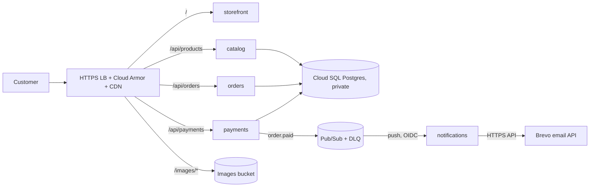

# Small e-commerce shop on Cloud Run (GCP)

Five modules, each its own Cloud Run service, behind one HTTPS load balancer.

| Module | Public? | Job |
|---|---|---|
| `storefront` | yes (`/`) | Product grid, cart (in the browser), checkout page with a demo card form (dummy payments, no real money) |
| `catalog` | yes (`/api/products`) | Lists products. Also owns the schema + seed job |
| `orders` | yes (`/api/orders`) | Creates an order: prices and stock are checked on the server, never trusted from the browser |
| `payments` | yes (`/api/payments`) | Dummy payment provider: creates a payment for an order, accepts test cards, marks the order paid and publishes an event |
| `notifications` | no (Pub/Sub only) | Sends the order confirmation email through **Brevo** |

Product images live in a Cloud Storage bucket served at `/images/*` through the CDN.

## Contents

1. [Architecture](#architecture)
2. [Purchase flow](#purchase-flow)
3. [Setup guide: deploy to Google Cloud](#setup-guide-deploy-to-google-cloud)
4. [Troubleshooting table](#troubleshooting)
5. [Decisions, trade-offs and known gaps](#decisions-and-trade-offs)
6. [Troubleshooting guide A: Workload Identity Federation 409 error](#troubleshooting-guide-a-workload-identity-federation-wif-409-error)
7. [Troubleshooting guide B: order emails not sending (Brevo)](#troubleshooting-guide-b-order-emails-not-sending-brevo)
8. [Root cause analysis (RCA): order confirmation emails not sent](#root-cause-analysis-rca-order-confirmation-emails-not-sent)

---

## Architecture



## Purchase flow

1. The storefront loads products from `/api/products`.
2. Customer clicks Continue to payment: `POST /api/orders` reserves stock and stores the order as `pending`.
3. `POST /api/payments/intent` creates a dummy payment for the total stored in the database.
4. The customer enters a test card and `POST /api/payments/confirm` runs. `4242 4242 4242 4242` succeeds, `4000 0000 0000 0002` is declined, anything else is rejected. The first success flips the order to `paid` and publishes `order.paid`.

   This is a stand-in for a real provider: no money moves. To go live, swap the `confirm` logic in `services/payments/main.py` for a real provider.
5. `notifications` receives the event and sends the email. Failures retry, then land in a dead-letter queue and trigger an alert.

---

# Setup guide: deploy to Google Cloud

Not yet applied against a real project, so treat the first run as a shakedown. If a step fails, the troubleshooting sections at the end cover the common causes.

## What you need

- A GCP project with billing enabled, and Owner access to it
- `gcloud` and Terraform 1.6 or newer on your computer
- A domain name you can add DNS records to
- A GitHub repository and the `gh` CLI
- A free [Brevo](https://www.brevo.com) account (for order emails, optional)

Tip: for your first run set `env = "dev"` in step 3. That gives a cheaper, non-HA database, no deletion protection and no minimum instances, so it is cheap and easy to tear down. Switch to `prod` when you are ready. In this project the prefix is `<app>-<env>` = `shop-prod`, and the commands below use it directly.

**Scripts:** every step below has a ready-made script in `scripts/` (bash: use Git Bash or WSL on Windows, or Cloud Shell). They read your settings from `terraform/terraform.tfvars`. Run one at a time, or `scripts/run-all.sh` for everything (`--from 4` resumes at step 4). The manual commands are kept below so you can see what each script does.

## 1. Log in and pick your project

Script: `scripts/01-login.sh`

```bash
cd terraform
gcloud auth login
gcloud auth application-default login
gcloud config set project boreal-conquest-421512
gcloud services enable serviceusage.googleapis.com cloudresourcemanager.googleapis.com
```

The last command lets Terraform turn on all the other APIs itself.

## 2. Create a bucket for Terraform state

Script: `scripts/02-state-bucket.sh`

```bash
gcloud storage buckets create gs://boreal-conquest-421512-tfstate --location=us-central1 --uniform-bucket-level-access
gcloud storage buckets update gs://boreal-conquest-421512-tfstate --versioning
```

## 3. Fill in your settings

Script: `scripts/03-configure.sh` (creates the two files; you still edit them)

```bash
cp terraform.tfvars.example terraform.tfvars
cp backend.hcl.example backend.hcl
```

Edit `backend.hcl`: set `bucket` to the state bucket from step 2.

Edit `terraform.tfvars`:

| Variable | Notes | Value used in this project |
|---|---|---|
| `project_id`, `region` | Your project and region | `boreal-conquest-421512`, `us-central1` |
| `app` | 8 characters or fewer. Resources are named `<app>-<env>` | `shop` |
| `env` | `dev` for testing, `prod` for real traffic | `prod` |
| `domain` | Your public hostname | `136-81-131-55.sslip.io` (test domain; replace with your own before go-live) |
| `github_repo` | `owner/name` of the repo that will deploy | `manojrasia/cloudrun` |
| `alert_email` | Receives monitoring alerts | `manoj1chaurasia2@gmail.com` |
| `email_from`, `shop_name` | Sender address and shop name for receipts. `email_from` must be a **verified sender in Brevo** | `manoj1chaurasia2@gmail.com`, `My Shop` |

## 4. Create the infrastructure

Script: `scripts/04-terraform.sh` (add `-y` to skip the confirmation)

```bash
terraform init -backend-config=backend.hcl
terraform plan
terraform apply
```

The first apply takes about 15 to 25 minutes, mostly waiting for the database. If it fails because an API is not ready yet, wait a minute and run `terraform apply` again. The services start with a placeholder image until step 8; that is expected.

## 5. Point your domain at the load balancer

Script: `scripts/05-dns.sh` (add `--wait` to poll until the certificate is `ACTIVE`)

```bash
terraform output lb_ip   # 136.81.131.55 for this project
```

Create a DNS **A record** for your domain with that address. (With the test domain `136-81-131-55.sslip.io` no DNS record is needed, because the hostname resolves to the IP inside the name.) The HTTPS certificate becomes active only after DNS resolves, which can take up to about an hour. Check it with:

```bash
gcloud compute ssl-certificates describe shop-prod-cert --global --format="get(managed.status)"
```

Wait for `ACTIVE`.

## 6. Add the email key (optional)

Script: `scripts/06-secrets.sh` (the script still reads its key from an environment variable named `SENDGRID_API_KEY`, left over from the old provider. The name does not matter, so put your Brevo key in it, or pass the key as the first argument.)

Payments are a built-in dummy, so there are no payment keys and no webhook to register. Terraform creates one third-party secret, the email key, with a placeholder value and never overwrites what you add.

The email provider is **Brevo**. To get a key:

1. Sign up at brevo.com and verify your sender under **Senders, Domains & Dedicated IPs → Senders**.
2. Go to **SMTP & API → API Keys** and generate an **API key**. It starts with `xkeysib-`.
   Do **not** use the SMTP key (it starts with `xsmtpsib-`). The API rejects it with `401 "Key not found"`.
3. If your Brevo account uses **Security → Authorized IPs**, either turn IP blocking off or authorize the IP address your Cloud Run service sends from. See [guide B](#troubleshooting-guide-b-order-emails-not-sending-brevo), section 4.
4. Store the key. Paste it and press Ctrl-D, so it stays out of your shell history:

```bash
gcloud secrets versions add shop-prod-email-api-key --data-file=-
```

The email key is optional. Without it, `notifications` only logs that it would have sent a receipt.

## 7. Connect GitHub

Script: `scripts/07-github.sh --push` (commits, pushes to `main`, and sets the variables; omit `--push` to only set variables)

Push the contents of this folder to your repo's `main` branch. The `.github` folder must sit at the repo root. Then set the variables the deploy workflow reads:

```bash
gh variable set GCP_PROJECT_ID  -R manojrasia/cloudrun --body "boreal-conquest-421512"
gh variable set GCP_REGION      -R manojrasia/cloudrun --body "us-central1"
gh variable set RESOURCE_PREFIX -R manojrasia/cloudrun --body "shop-prod"
gh variable set WIF_PROVIDER    -R manojrasia/cloudrun --body "$(terraform output -raw wif_provider)"
gh variable set DEPLOYER_SA     -R manojrasia/cloudrun --body "$(terraform output -raw deployer_service_account)"
```

You can also set them in the repo under Settings, Secrets and variables, Actions, Variables. Only the `main` branch of the exact `owner/name` repo from step 3 can deploy; GitHub authenticates to Google with short-lived tokens, so there are no keys to store.

## 8. Deploy the code

Script: `scripts/08-deploy.sh` (triggers the workflow and waits for it)

Push to `main`, or run the workflow manually from the Actions tab. It builds the five images, creates the database tables and 6 sample products, then deploys each service as a new revision. Until it finishes, the services show the placeholder page.

## 9. Upload product images

Script: `scripts/09-images.sh`

```bash
gcloud storage cp ./images/*.jpg gs://boreal-conquest-421512-shop-prod-images/images/
```

The sample products expect `tee.jpg`, `mug.jpg`, `tote.jpg`, `cap.jpg`, `notebook.jpg` and `stickers.jpg`.

## 10. Test it

Script: `scripts/10-test.sh` runs the whole purchase against your live domain (order, declined card, successful card, order shows `paid`) and prints the recent logs.

Or by hand:

1. Open your domain and check that the products appear.
2. Add something to the cart and pay with the test card `4242 4242 4242 4242` (any future expiry, any 3-digit CVC; the form is pre-filled).
3. Check the logs:

```bash
gcloud run services logs read shop-prod-payments --region us-central1 --limit 20
gcloud run services logs read shop-prod-notifications --region us-central1 --limit 20
```

You should see "order paid" in the `payments` logs. In the `notifications` logs you should see `confirmation handled order_id=...`. Without an email key, `notifications` logs a warning instead of sending.

Going live: replace the dummy `confirm` logic with a real payment provider, set `env = "prod"`, apply, then re-run the deploy workflow.

## Troubleshooting

| Symptom | Likely cause and fix |
|---|---|
| Apply fails on `allUsers` | Your organization blocks public access (domain-restricted sharing). The public services and image bucket need it. Change the policy for this project, or put IAP in front of the load balancer |
| Apply fails with `Error 409: Requested entity already exists` on the workload identity pool | A deleted pool still reserves its ID for 30 days. See [guide A](#troubleshooting-guide-a-workload-identity-federation-wif-409-error) |
| Browser shows a certificate error | DNS is not set or has not propagated. Re-check step 5 |
| Payment is declined | Only test cards work: `4242 4242 4242 4242` succeeds, `4000 0000 0000 0002` is declined |
| Changed a secret but nothing changed | Services read secrets when a revision starts. Re-run the deploy workflow, or run `gcloud run services update ... --update-secrets=...:latest` |
| Storefront loads but products are empty | The migration job has not run. Run the deploy workflow and check its "Run DB migrations" step |
| Workflow fails to authenticate | Check the `WIF_PROVIDER` and `DEPLOYER_SA` variables, and that `github_repo` matches exactly and you are pushing to `main` |
| Order paid but no confirmation email; `notifications` logs show `status=401` | See [guide B](#troubleshooting-guide-b-order-emails-not-sending-brevo) and the [RCA](#root-cause-analysis-rca-order-confirmation-emails-not-sent) |

## Cleaning up

Run `scripts/destroy.sh` (or `terraform destroy` from the `terraform` folder). In `dev` it works directly. In `prod`, deletion protection must be turned off first. The state bucket from step 2 is separate; delete it yourself.

---

## Decisions and trade-offs

- One Cloud SQL database shared by `catalog`, `orders` and `payments` (separate tables, one owner for migrations). Simple and cheap for a small shop. Split databases only if teams or scale demand it.
- Prices and stock are always read server-side. The cart lives in the browser only.
- No Redis and no NAT: not needed at this size. Add them if you add sessions or rate-limited third-party APIs. (If you want a fixed outbound IP for Brevo's IP allowlist, you will need Cloud NAT. See guide B, section 4.)
- Only `payments` can publish events; only `notifications` can read the email key. Each service has its own identity.
- Cloud Armor: WAF rules and per-IP rate limiting.
- Cost drivers: the load balancer and Cloud SQL (especially with `env = "prod"`, which turns on high availability and minimum instances).

## Known gaps before real launch

- Stock is reserved when an order is created but not released if the customer abandons payment. Add a scheduled job to cancel old `pending` orders and restock.
- No admin UI or customer accounts. Add a back-office module or use SQL tooling for now.
- `GET /api/orders/{id}` is protected only by the unguessable order ID.
- Tax, shipping and refunds are not implemented.
- Payments are a dummy: anyone can pay with a test card, so no real revenue can be collected until a real provider is added.
- Single region. For disaster recovery, replicate the stack in a second region and add a Cloud SQL cross-region replica.
- Email is sent from a Gmail address, which hurts deliverability. Authenticate your own domain in Brevo before launch.

---

# Troubleshooting guide A: Workload Identity Federation (WIF) 409 error

Project: `boreal-conquest-421512` · Pool: `shop-prod-gh` · Provider: `github`

## Issue

`terraform apply` failed with:

```
Error 409: Requested entity already exists
(google_iam_workload_identity_pool.github)
```

Cause:

- A pool with the ID `shop-prod-gh` had been created earlier and then deleted.
- GCP soft-deletes pools and providers and reserves the ID for 30 days, so Terraform could not create a new pool with the same ID.
- The deleted pool was not in Terraform state, so `terraform destroy -target` did nothing and should not be used here.
- `providers list` returned NOT_FOUND because a deleted pool hides its providers.

## Fix

1. Find the deleted pool (include soft-deleted ones):

   ```bash
   gcloud iam workload-identity-pools list \
     --project=boreal-conquest-421512 --location=global --show-deleted
   ```

   Result: `shop-prod-gh` was in state `DELETED`.

2. Undelete the pool:

   ```bash
   gcloud iam workload-identity-pools undelete shop-prod-gh \
     --project=boreal-conquest-421512 --location=global
   ```

3. List providers (include soft-deleted ones):

   ```bash
   gcloud iam workload-identity-pools providers list \
     --workload-identity-pool=shop-prod-gh --location=global \
     --project=boreal-conquest-421512 --show-deleted \
     --format="table(name.basename(), state)"
   ```

   Result: provider `github` was in state `DELETED`.

4. Undelete the provider:

   ```bash
   gcloud iam workload-identity-pools providers undelete github \
     --workload-identity-pool=shop-prod-gh --location=global \
     --project=boreal-conquest-421512
   ```

5. Confirm both are `ACTIVE` (each should print `ACTIVE`):

   ```bash
   gcloud iam workload-identity-pools describe shop-prod-gh \
     --project=boreal-conquest-421512 --location=global \
     --format="value(state)"

   gcloud iam workload-identity-pools providers describe github \
     --workload-identity-pool=shop-prod-gh --location=global \
     --project=boreal-conquest-421512 --format="value(state)"
   ```

6. Import both into Terraform state:

   ```bash
   terraform import google_iam_workload_identity_pool.github \
     projects/boreal-conquest-421512/locations/global/workloadIdentityPools/shop-prod-gh

   terraform import google_iam_workload_identity_pool_provider.github \
     projects/boreal-conquest-421512/locations/global/workloadIdentityPools/shop-prod-gh/providers/github
   ```

7. Plan and apply only the resources in `cicd.tf`:

   ```bash
   terraform plan -out tfplan \
     -target=google_iam_workload_identity_pool.github \
     -target=google_iam_workload_identity_pool_provider.github \
     -target=google_service_account_iam_member.wif \
     -target=google_artifact_registry_repository_iam_member.deployer_push \
     -target=google_project_iam_member.deployer_run \
     -target=google_service_account_iam_member.deployer_actas

   terraform apply tfplan
   ```

   Expected: pool and provider show no changes (or a small provider update); the `wif`, `deployer_push` and `deployer_actas` bindings are created.
   Note: `-target` also pulls in resources these depend on (deployer SA, runtime SAs, Artifact Registry repo, APIs) if they are not yet in state.

8. Run a plain `terraform plan` to confirm there is no remaining drift.

9. GitHub Actions setup:
   - Get the values: `terraform output wif_provider` and `terraform output deployer_sa_email`.
   - Store them as repo variables `WIF_PROVIDER` and `DEPLOYER_SA`.
   - The workflow needs `permissions: id-token: write` and `contents: read`.
   - Auth only works for the configured repo on `refs/heads/main` (pull requests and tags are rejected by the attribute condition).

## Useful check commands

```bash
# Who can impersonate the deployer SA
gcloud iam service-accounts get-iam-policy \
  shop-prod-deployer@boreal-conquest-421512.iam.gserviceaccount.com \
  --project=boreal-conquest-421512

# Deployer's Artifact Registry access
gcloud artifacts repositories get-iam-policy shop-prod-images \
  --project=boreal-conquest-421512 --location=us-central1

# Deployer's project-level roles
gcloud projects get-iam-policy boreal-conquest-421512 \
  --flatten="bindings[].members" \
  --filter="bindings.members:serviceAccount:shop-prod-deployer@boreal-conquest-421512.iam.gserviceaccount.com" \
  --format="table(bindings.role)"
```

## How to avoid this next time

- Do not delete pools or providers you plan to reuse. The ID stays reserved for 30 days after deletion.
- On a 409, run `list --show-deleted` first. The pool is either active (import it) or deleted (undelete it, then import it).
- If you must recreate one, use a new ID (for example `shop-prod-gh2`).
- Do not run `terraform destroy -target` on resources that are not in state.

---

# Troubleshooting guide B: order emails not sending (Brevo)

Service: `shop-prod-notifications` (Cloud Run, `us-central1`), fed by Pub/Sub push to `/pubsub/push`
Date: 2026-11-28
Status: **Fixed. Emails are being delivered through Brevo.**

## 1. Summary

Order confirmation emails were not being sent. Each `order.paid` event reached the notifications service, but the call to the email provider failed with **HTTP 401 Unauthorized**. The service returned 500, so Pub/Sub kept retrying.

Three separate problems were found and fixed, one after another:

| # | Problem | Fix |
|---|---|---|
| 1 | The secret `shop-prod-email-api-key` held a junk value (`manoj`), and an earlier version held the `REPLACE_ME` placeholder. | Added a real key as a new secret version and disabled the bad one. |
| 2 | The provider was SendGrid, which no longer has a free plan (60-day trial only). | Switched the code to Brevo (free tier of 300 emails/day). |
| 3 | The first Brevo value stored was an **SMTP key** (`xsmtpsib-...`). The transactional API needs an **API key** (`xkeysib-...`). Brevo also blocked requests from unrecognized IP addresses (see section 4). | Created an API key and added the Cloud Run IP addresses in Brevo → Security → Authorized IPs. Mail then worked. |

## 2. Timeline of what was observed

1. **Original error** in the logs: `urllib.error.HTTPError: HTTP Error 401: Unauthorized`, raised from `send_email` (`main.py` line 43) via the `push` handler. The request was an outbound call to SendGrid, not Pub/Sub authentication. The traceback proved this, because the app code was running.
2. Checked the Cloud Run env config. `EMAIL_API_KEY` was wired to secret `shop-prod-email-api-key`, version `latest`. The wiring was correct, so the value was suspect.
3. Listed secret versions and read the latest value. It was the literal text `manoj`, not an API key. Version 1 was the Terraform placeholder `REPLACE_ME`.
4. Decided to move off SendGrid (no permanent free plan). Chose Brevo (300 emails/day free, no expiry).
5. Rewrote `send_email` for Brevo and added logging of the provider's response body.
6. After the deploy, the log showed `brevo send failed status=401 body={"message":"Key not found","code":"unauthorized"}`. The new code was running, but Brevo did not accept the key.
7. Checked the secret: it started with `xsmtpsib-`, which is an SMTP key. Replaced it with an API key (`xkeysib-`).
8. Still 401 for a while. In Brevo, added the Cloud Run IP addresses as authorized IPs. Mail then worked.

## 3. Changes made, in order

### Code (`services/notifications/main.py`)

- `send_email` now calls Brevo's transactional API:
  - URL: `https://api.brevo.com/v3/smtp/email`
  - Header: `api-key: <key>` (SendGrid used `Authorization: Bearer`)
  - Body fields: `sender`, `to`, `subject`, `textContent`
  - Success status: `201`
- The key is `.strip()`ped, so a stray newline or space in the secret cannot break auth.
- Added `import urllib.error` and a `try/except HTTPError` that logs the status code and the first 500 characters of the response body, then re-raises. Before this, the logs only said "HTTP Error 401".
- The `REPLACE_ME` placeholder behavior is unchanged: with the placeholder, the service only logs a warning.
- Deployed by pushing to `main` (GitHub Actions workflow `build-and-deploy`).

### Secret Manager (`shop-prod-email-api-key`)

| Version | Content | State |
|---|---|---|
| 1 | `REPLACE_ME` (Terraform placeholder) | enabled (harmless) |
| 2 | `manoj` (junk) | disabled |
| 3 | Brevo SMTP key (`xsmtpsib-...`), wrong type | disable it |
| 4 | Brevo API key (`xkeysib-...`) | enabled, the one in use |

Commands used:

```bash
# add a new version (paste key, Enter, Ctrl-D, so it stays out of shell history)
gcloud secrets versions add shop-prod-email-api-key --data-file=-

# disable a bad version
gcloud secrets versions disable 2 --secret=shop-prod-email-api-key

# make the service pick up the latest version
gcloud run services update shop-prod-notifications --region us-central1 \
  --update-secrets=EMAIL_API_KEY=shop-prod-email-api-key:latest
```

### Brevo dashboard

- Verified the sender address (`EMAIL_FROM`) under **Senders, Domains & Dedicated IPs → Senders**.
- Generated an **API key** under **SMTP & API → API Keys** (not the SMTP tab).
- Added authorized IPs under **Security → Authorized IPs** (see section 4).

## 4. The Brevo authorized-IP issue

Brevo can restrict API access to approved IP addresses. When a request comes from an unknown IP, the API refuses it with a 401, even if the key is correct. The two addresses that were added (both listed as "Automatic", Nov 28, 2026, 11:04 PM in Brevo's local time):

| IP | Owner |
|---|---|
| `106.202.138.51` | Bharti Airtel Ltd. (home/office connection, used for local `curl` tests) |
| `2600:1900:0:2d0e::1500` | Google LLC (Cloud Run's outbound address) |

**Warning: this is fragile.** Cloud Run does not have a fixed outbound IP by default. Google can use a different address from its ranges at any time, and mail will fail again with a 401 when that happens. Pick one of these:

- **Easiest:** in Brevo → Security → Authorized IPs, turn off IP blocking (deactivate the restriction). The API key alone then protects the account. Keep the key in Secret Manager only, and never in the repo.
- **Most robust:** give Cloud Run a fixed outbound IP. Route egress through a VPC connector or Direct VPC egress plus Cloud NAT with a reserved static IP, then authorize only that IP in Brevo. The repo's `terraform/network.tf` is where that would go.

Your home IP (`106.202.138.51`) also changes if your ISP gives you a new address. Remove it once testing is done.

## 5. Investigation playbook (reuse this next time)

### Step 1: Read the logs

```bash
gcloud run services logs read shop-prod-notifications --region us-central1 --limit 40
```

Look for the line **before** the traceback. The new code logs `brevo send failed status=... body=...`.

| Log line | Meaning | Action |
|---|---|---|
| `EMAIL_API_KEY not configured; would send...` | Placeholder key is in use. | Add a real key and redeploy. |
| `HTTP Error 401` with no provider body | Old code still running, or the error is not being logged. | Check that the deploy finished. |
| `status=401 "Key not found"` | The key is wrong, the wrong type, or the IP is not authorized. | Run Step 3, then Step 4. |
| `status=400` (sender error) | The From address is not verified. | Verify it in the provider's Senders page. |
| `status=403` | Account not activated, or missing permission. | Check the provider's account status. |
| `confirmation handled order_id=...` | The provider accepted the email. | Check spam and the provider's logs. |

### Step 2: Check what the service is configured to use

```bash
gcloud run services describe shop-prod-notifications --region us-central1 \
  --format="yaml(spec.template.spec.containers[0].env)"
gcloud secrets versions list shop-prod-email-api-key
```

Confirm the secret name and that it uses `latest` or the version you expect.

### Step 3: Inspect the stored key safely (never print the whole key)

```bash
gcloud secrets versions access latest --secret=shop-prod-email-api-key | cut -c1-9
gcloud secrets versions access latest --secret=shop-prod-email-api-key | wc -c
```

- Brevo API key: starts with `xkeysib-`
- Brevo SMTP key: starts with `xsmtpsib-` (wrong for this API)
- `manoj` or `REPLACE_ME`: not a key

### Step 4: Test the key outside the app

```bash
curl -s https://api.brevo.com/v3/account \
  -H "api-key: $(gcloud secrets versions access latest --secret=shop-prod-email-api-key)"
```

- Account details returned: the key is valid.
- `Key not found` or a message about an unrecognized IP: the key is bad, or the IP is not authorized.

### Step 5: Send a real test email

```bash
curl -s -X POST https://api.brevo.com/v3/smtp/email \
  -H "api-key: $(gcloud secrets versions access latest --secret=shop-prod-email-api-key)" -H "Content-Type: application/json" \
  -d '{"sender":{"email":"manoj1chaurasia2@gmail.com","name":"Test"},"to":[{"email":"manoj1chaurasia2@gmail.com"}],"subject":"test","textContent":"hello"}'
```

A success returns a `messageId`.

### Step 6: Make the service use the new secret

```bash
gcloud run services update shop-prod-notifications --region us-central1 \
  --update-secrets=EMAIL_API_KEY=shop-prod-email-api-key:latest
```

Secrets referenced as `latest` are read when an instance starts, so running instances keep the old value until a new revision is deployed.

### Step 7: Confirm the fix

Place a test order (card `4242 4242 4242 4242`) or wait for Pub/Sub to redeliver. The logs should show `confirmation handled`. Also check Brevo → **Transactional → Logs**, and the spam folder.

## 6. Behavior to know about

- **Pub/Sub retries failed messages**, then moves them to the dead-letter queue after 5 attempts. Orders that failed during the outage may or may not have their emails sent, depending on retention and the dead-letter threshold.
- **Delivery is at-least-once**, so a customer can occasionally get a duplicate email.
- **A 500 from `/pubsub/push` is expected while the provider is failing.** It means "retry me". It is not a crash.

---

# Root cause analysis (RCA): order confirmation emails not sent

| | |
|---|---|
| **Date** | 2026-11-28 |
| **Service** | `shop-prod-notifications` (Cloud Run, `us-central1`) |
| **Severity** | Medium. Orders and payments still worked, but no customer received a confirmation email. |
| **Status** | Resolved |
| **Detected** | `/pubsub/push` returning HTTP 500 in the Cloud Run logs (first seen in the logs at 16:39 UTC) |

## 1. Impact

- Every `order.paid` event failed in the notifications service, so customers got **no confirmation email**.
- Pub/Sub retried each failed message with backoff, so the logs filled with repeated errors. After 5 attempts a message goes to the dead-letter queue (which also raises an alert).
- No money moved (payments are a dummy), and no orders or stock data were lost.

## 2. Timeline (UTC, from the logs and Secret Manager)

| Time | Event |
|---|---|
| 14:32 | Secret `shop-prod-email-api-key` version 1 created. This is the Terraform placeholder `REPLACE_ME`. |
| 16:12 | Version 2 added. Its value was the text `manoj`, not an API key. |
| 16:39 | First failures in the logs: `POST /pubsub/push 500`, caused by `HTTP Error 401: Unauthorized` from `send_email` (`main.py` line 43). |
| after 16:39 | Investigation: the error was an outbound call. The secret value was `manoj`. The provider (SendGrid) no longer offers a permanent free plan. Decision: move to Brevo. |
| 17:08 | Version 3 added: a Brevo **SMTP key** (`xsmtpsib-...`). |
| ~17:26 | New Brevo code deployed. Logs now show `brevo send failed status=401 body={"message":"Key not found","code":"unauthorized"}`. |
| after 17:26 | Diagnosed: the stored value is an SMTP key, and the API needs an API key (`xkeysib-`). |
| 17:32 | Still failing with the same `Key not found` error. |
| ~17:34 (11:04 PM in Brevo, local time) | Two IP addresses added in Brevo → Security → Authorized IPs: the home connection and a Google (Cloud Run) address. |
| after 17:34 | Mail delivered. Issue resolved. |

## 3. Root causes

The failure had three layered causes. Fixing one revealed the next, which is why it took several rounds.

### Root cause 1: an invalid value in the email secret (primary)

The secret `shop-prod-email-api-key` held `manoj` (a name typed in by mistake) instead of an API key. The provider rejected every request with 401.

Why it happened: Terraform creates the secret with a placeholder (`REPLACE_ME`) and never overwrites later versions, so any value can be added with no validation. Nothing in the pipeline checks that the value looks like a real key.

### Root cause 2: wrong provider and wrong credential type

- The code called SendGrid, which has no permanent free plan (60-day trial only), so a working free key was not available.
- After moving to Brevo, an **SMTP key** (`xsmtpsib-...`) was stored. Brevo's HTTP API (`/v3/smtp/email`) only accepts an **API key** (`xkeysib-...`). The two keys look alike and live on neighboring tabs in the Brevo dashboard.

### Root cause 3: Brevo IP restriction (most likely the last blocker)

Brevo's **Authorized IPs** feature rejects API calls from addresses that are not approved, and the rejection looks like a 401 even with a valid key. Cloud Run's outbound requests come from Google addresses that Brevo had not seen. Mail started working after the Google IP and the home IP were added in Brevo, with no other change recorded at the time. This is the best-supported explanation, but the logs never printed Brevo's reason directly, so treat it as the likely cause rather than proof.

## 4. Why it was hard to see

- The original code did not log the provider's response, so the logs showed only `HTTP Error 401: Unauthorized` with no reason. The new code logs the status and body, which is what exposed `Key not found`.
- The same 401 status was produced by three different causes (junk value, wrong key type, blocked IP), so each fix looked like it "did nothing".
- Secrets referenced as `latest` are read only when an instance starts. After changing the secret, running instances kept the old value until a new revision was deployed.
- Pub/Sub retries made one problem look like many failures.

## 5. What went well

- The traceback showed immediately that this was an outbound call, not Pub/Sub authentication.
- Reading the secret's first characters (without printing the key) identified the bad values quickly.
- The service kept running, with `/healthz` returning 200, and the handler failed safely (500 → retry) instead of dropping messages.
- Dead-letter queue and alerting were already in place.

## 6. What could be better

- No validation of the email key before or after storing it.
- Logging was too thin to show the provider's reason.
- A secret was pasted into a terminal and a text note during troubleshooting. See action item 1.
- The provider's IP allowlist is fragile with Cloud Run's changing outbound addresses.
- The sender is a Gmail address, which hurts deliverability.

## 7. Action items

| # | Action | Priority | Status |
|---|---|---|---|
| 1 | **Revoke the exposed SMTP key.** The key was pasted into a `README` troubleshooting note. In Brevo → SMTP & API → SMTP tab, delete it. Never keep real keys in notes or in the repo. | High | Open |
| 2 | Disable secret version 3 (the SMTP key) in Secret Manager. | High | Open |
| 3 | Decide on the IP approach: turn off Brevo's IP blocking, or give Cloud Run a static egress IP with Cloud NAT and authorize only that IP. Remove the home IP. | High | Open |
| 4 | Remove `twilio_2FA_recovery_code.txt` from the repo and regenerate the recovery code (it is in git history, commit `a61cf76`). | High | Open |
| 5 | Keep the improved logging in `send_email` (status and body on failure). | Medium | Done |
| 6 | Add a startup check: on boot, `notifications` calls Brevo's `GET /v3/account` once and logs a clear error if the key does not work. | Medium | Open |
| 7 | Make the handler acknowledge (return 2xx) on non-retryable errors such as a 401 or 400, and rely on a dead-letter queue and alert, so a bad key does not cause endless retries. | Medium | Open |
| 8 | Authenticate your own domain in Brevo and change `EMAIL_FROM` from the Gmail address to an address on that domain. | Medium | Open |
| 9 | Add an alert on notifications 5xx rate or on `brevo send failed` log lines. | Medium | Open |
| 10 | Update the setup script (`scripts/06-secrets.sh`) to use a neutral variable name instead of `SENDGRID_API_KEY`, and to refuse keys that do not start with `xkeysib-`. | Low | Open |
| 11 | Document that the secret value is not validated by Terraform (done in step 6 of this README). | Low | Done |

## 8. Lessons

1. **Log the provider's response body on failure.** A bare "401" hides the real reason.
2. **Check what is actually stored before debugging code.** Printing the first few characters of a secret (`cut -c1-9`) found two bugs in minutes.
3. **Know your provider's key types.** Brevo has separate SMTP and API keys, and only the API key works with the HTTP API.
4. **Check provider-side restrictions.** IP allowlists look exactly like bad credentials.
5. **Secrets read at startup need a new revision.** Redeploy or update the service after changing a secret.
6. **Never write real keys into notes, tickets or chat.** Treat anything pasted as exposed and rotate it.

---

# Troubleshooting guide C: Terraform state lock error (`Error acquiring the state lock`)

Date seen: 2026-11-28 · State bucket: `gs://boreal-conquest-421512-tfstate` · State prefix: `acme/prod`

## Symptom

Running `./destroy.sh` (or `terraform plan` / `apply`) failed with:

```
Error: Error acquiring the state lock

Error message: writing "gs://boreal-conquest-421512-tfstate/acme/prod/default.tflock" failed:
googleapi: Error 412: At least one of the pre-conditions you specified did not hold., conditionNotMet
Lock Info:
  ID:        1795882491971436
  Path:      gs://boreal-conquest-421512-tfstate/acme/prod/default.tflock
  Operation: OperationTypeApply
  Who:       DELL\manoj@DELL
  Version:   1.17.0
  Created:   2026-11-28 16:14:50 +0000 UTC
```

## Cause

Terraform writes a lock file (`default.tflock`) into the state bucket when a run starts, and deletes it when the run ends. The lock stays behind if the run does not end normally. The lock info shows that an earlier `terraform apply` (from `DELL\manoj@DELL`, started at 16:14 UTC) never released it. Common reasons:

- Ctrl-C pressed twice, or the terminal or laptop was closed during the run.
- The apply crashed, or the network dropped. The first apply takes 15 to 25 minutes, mostly waiting for the database, so it is easy to interrupt.
- That apply is still running in another terminal window.

## Fix

1. **Make sure no other Terraform run is active.** Check for a `terraform` process (Task Manager on Windows, or other terminals), and check that no teammate is applying. Releasing the lock during a live run can corrupt the state.
2. **Release the lock** from the `terraform` folder, using the ID from the error:

   ```bash
   terraform force-unlock 1795882491971436
   ```

   Type `yes` when asked.
3. **Check for drift.** The interrupted apply may have stopped halfway, so run this before anything else:

   ```bash
   terraform plan
   ```

   It shows whether the state matches what is actually deployed.
4. **If `force-unlock` fails**, delete the lock file directly:

   ```bash
   gcloud storage rm gs://boreal-conquest-421512-tfstate/acme/prod/default.tflock
   ```

## Before running `destroy.sh`

The environment is `prod`. Destroy deletes the load balancer, the Cloud SQL database and every service, including all orders. Prod has deletion protection, so destroy fails unless that is turned off first. If you only needed to clear the lock, stop after step 3. The state bucket is not removed by `destroy.sh`.

## How to avoid this next time

- Let `terraform apply` finish. If you must stop it, press Ctrl-C **once** and wait, so Terraform can release the lock.
- Run Terraform in one terminal at a time.
- Use `terraform force-unlock` only after confirming nothing else is running.
