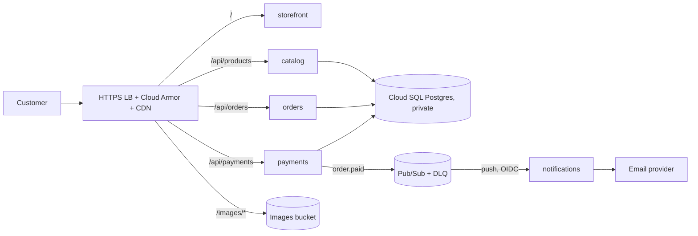

# Small e-commerce shop on Cloud Run (GCP)

Five modules, each its own Cloud Run service, behind one HTTPS load balancer.

| Module | Public? | Job |
|---|---|---|
| `storefront` | yes (`/`) | Product grid, cart (in the browser), checkout page with a demo card form (dummy payments, no real money) |
| `catalog` | yes (`/api/products`) | Lists products. Also owns the schema + seed job |
| `orders` | yes (`/api/orders`) | Creates an order: prices and stock are checked on the server, never trusted from the browser |
| `payments` | yes (`/api/payments`) | Dummy payment provider: creates a payment for an order, accepts test cards, marks the order paid and publishes an event |
| `notifications` | no (Pub/Sub only) | Sends the order confirmation email |

Product images live in a Cloud Storage bucket served at `/images/*` through the CDN.

## Architecture



## Purchase flow

1. The storefront loads products from `/api/products`.
2. Customer clicks Continue to payment: `POST /api/orders` reserves stock and stores the order as `pending`.
3. `POST /api/payments/intent` creates a dummy payment for the total stored in the database.
4. The customer enters a test card and `POST /api/payments/confirm` runs. `4242 4242 4242 4242` succeeds, `4000 0000 0000 0002` is declined, anything else is rejected. The first success flips the order to `paid` and publishes `order.paid`.

This is a stand-in for a real provider: no money moves. To go live, swap the `confirm` logic in `services/payments/main.py` for a real provider.
5. `notifications` receives the event and sends the email. Failures retry, then land in a dead-letter queue and trigger an alert.

---

# Setup guide: deploy to Google Cloud

Not yet applied against a real project, so treat the first run as a shakedown. If a step fails, the troubleshooting section at the end covers the common causes.

## What you need

- A GCP project with billing enabled, and Owner access to it
- `gcloud` and Terraform 1.6 or newer on your computer
- A domain name you can add DNS records to
- A GitHub repository and the `gh` CLI

Tip: for your first run set `env = "dev"` in step 3. That gives a cheaper, non-HA database, no deletion protection and no minimum instances, so it is cheap and easy to tear down. Switch to `prod` when you are ready. In the commands below, `<prefix>` means `<app>-<env>`, for example `shop-dev`.

**Scripts:** every step below has a ready-made script in `scripts/` (bash: use Git Bash or WSL on Windows, or Cloud Shell). They read your settings from `terraform/terraform.tfvars`. Run one at a time, or `scripts/run-all.sh` for everything (`--from 4` resumes at step 4). The manual commands are kept below so you can see what each script does.

## 1. Log in and pick your project

Script: `scripts/01-login.sh`

```bash
cd terraform
gcloud auth login
gcloud auth application-default login
gcloud config set project YOUR_PROJECT_ID
gcloud services enable serviceusage.googleapis.com cloudresourcemanager.googleapis.com
```

The last command lets Terraform turn on all the other APIs itself.

## 2. Create a bucket for Terraform state

Script: `scripts/02-state-bucket.sh`

```bash
gcloud storage buckets create gs://boreal-conquest-421512-tfstate --location=us-central1 --uniform-bucket-level-access
gcloud storage buckets update gs://boreal-conquest-421512-tfstate --versioning
```

## 3. Fill in your settings

Script: `scripts/03-configure.sh` (creates the two files; you still edit them)

```bash
cp terraform.tfvars.example terraform.tfvars
cp backend.hcl.example backend.hcl
```

Edit `backend.hcl`: set `bucket` to the state bucket from step 2.

Edit `terraform.tfvars`:

| Variable | Notes |
|---|---|
| `project_id`, `region` | Your project and region |
| `app` | 8 characters or fewer. Resources are named `<app>-<env>` |
| `env` | `dev` for testing, `prod` for real traffic |
| `domain` | For example `shop.example.com` |
| `github_repo` | `owner/name` of the repo that will deploy |
| `alert_email` | Receives monitoring alerts |
| `email_from`, `shop_name` | Sender address and shop name for receipts |

## 4. Create the infrastructure

Script: `scripts/04-terraform.sh` (add `-y` to skip the confirmation)

```bash
terraform init -backend-config=backend.hcl
terraform plan
terraform apply
```

The first apply takes about 15 to 25 minutes, mostly waiting for the database. If it fails because an API is not ready yet, wait a minute and run `terraform apply` again. The services start with a placeholder image until step 8; that is expected.

## 5. Point your domain at the load balancer

Script: `scripts/05-dns.sh` (add `--wait` to poll until the certificate is `ACTIVE`)

```bash
terraform output lb_ip
```

Create a DNS **A record** for your domain with that address. The HTTPS certificate becomes active only after DNS resolves, which can take up to about an hour. Check it with:

```bash
gcloud compute ssl-certificates describe <prefix>-cert --global --format="get(managed.status)"
```

Wait for `ACTIVE`.

## 6. Add the email key (optional)

Script: `SENDGRID_API_KEY=SG.xxx scripts/06-secrets.sh`

Payments are a built-in dummy, so there are no payment keys and no webhook to register. Terraform creates one third-party secret, the email key, with a placeholder value and never overwrites what you add:

```bash
echo -n "SG.your-key" | gcloud secrets versions add <prefix>-email-api-key --data-file=-
```

The email key (SendGrid) is optional. Without it, `notifications` only logs that it would have sent a receipt.

## 7. Connect GitHub

Script: `scripts/07-github.sh --push` (commits, pushes to `main`, and sets the variables; omit `--push` to only set variables)

Push the contents of this folder to your repo's `main` branch. The `.github` folder must sit at the repo root. Then set the variables the deploy workflow reads:

```bash
gh variable set GCP_PROJECT_ID  -R manojrasia/cloudrun --body "boreal-conquest-421512"
gh variable set GCP_REGION      -R manojrasia/cloudrun --body "us-central1"
gh variable set RESOURCE_PREFIX -R manojrasia/cloudrun --body "shop-prod"
gh variable set WIF_PROVIDER    -R manojrasia/cloudrun --body "$(terraform output -raw wif_provider)"
gh variable set DEPLOYER_SA     -R manojrasia/cloudrun --body "$(terraform output -raw deployer_service_account)"
```

You can also set them in the repo under Settings, Secrets and variables, Actions, Variables. Only the `main` branch of the exact `owner/name` repo from step 3 can deploy; GitHub authenticates to Google with short-lived tokens, so there are no keys to store.

## 8. Deploy the code

Script: `scripts/08-deploy.sh` (triggers the workflow and waits for it)

Push to `main`, or run the workflow manually from the Actions tab. It builds the five images, creates the database tables and 6 sample products, then deploys each service as a new revision. Until it finishes, the services show the placeholder page.

## 9. Upload product images

Script: `scripts/09-images.sh`

```bash
gcloud storage cp ./images/*.jpg gs://boreal-conquest-421512-shop-prod-images/images/
```

The sample products expect `tee.jpg`, `mug.jpg`, `tote.jpg`, `cap.jpg`, `notebook.jpg` and `stickers.jpg`.

## 10. Test it

Script: `scripts/10-test.sh` runs the whole purchase against your live domain (order, declined card, successful card, order shows `paid`) and prints the recent logs.

Or by hand:

1. Open your domain and check that the products appear.
2. Add something to the cart and pay with the test card `4242 4242 4242 4242` (any future expiry, any 3-digit CVC; the form is pre-filled).
3. Check the logs:

```bash
gcloud run services logs read <prefix>-payments --region us-central1 --limit 20
gcloud run services logs read <prefix>-notifications --region us-central1 --limit 20
```

You should see "order paid" in the `payments` logs. Without an email key, `notifications` logs a warning instead of sending.

Going live: replace the dummy `confirm` logic with a real payment provider, set `env = "prod"`, apply, then re-run the deploy workflow.

## Troubleshooting

| Symptom | Likely cause and fix |
|---|---|
| Apply fails on `allUsers` | Your organization blocks public access (domain-restricted sharing). The public services and image bucket need it. Change the policy for this project, or put IAP in front of the load balancer |
| Browser shows a certificate error | DNS is not set or has not propagated. Re-check step 5 |
| Payment is declined | Only test cards work: `4242 4242 4242 4242` succeeds, `4000 0000 0000 0002` is declined |
| Changed a secret but nothing changed | Services read secrets when a revision starts. Re-run the deploy workflow |
| Storefront loads but products are empty | The migration job has not run. Run the deploy workflow and check its "Run DB migrations" step |
| Workflow fails to authenticate | Check the `WIF_PROVIDER` and `DEPLOYER_SA` variables, and that `github_repo` matches exactly and you are pushing to `main` |

## Cleaning up

Run `scripts/destroy.sh` (or `terraform destroy` from the `terraform` folder). In `dev` it works directly. In `prod`, deletion protection must be turned off first. The state bucket from step 2 is separate; delete it yourself.

---

## Decisions and trade-offs

- One Cloud SQL database shared by `catalog`, `orders` and `payments` (separate tables, one owner for migrations). Simple and cheap for a small shop. Split databases only if teams or scale demand it.
- Prices and stock are always read server-side. The cart lives in the browser only.
- No Redis and no NAT: not needed at this size. Add them if you add sessions or rate-limited third-party APIs.
- Only `payments` can publish events; only `notifications` can read the email key. Each service has its own identity.
- Cloud Armor: WAF rules and per-IP rate limiting.
- Cost drivers: the load balancer and Cloud SQL (especially with `env = "prod"`, which turns on high availability and minimum instances).

## Known gaps before real launch

- Stock is reserved when an order is created but not released if the customer abandons payment. Add a scheduled job to cancel old `pending` orders and restock.
- No admin UI or customer accounts. Add a back-office module or use SQL tooling for now.
- `GET /api/orders/{id}` is protected only by the unguessable order ID.
- Tax, shipping and refunds are not implemented.
- Payments are a dummy: anyone can pay with a test card, so no real revenue can be collected until a real provider is added.
- Single region. For disaster recovery, replicate the stack in a second region and add a Cloud SQL cross-region replica.
